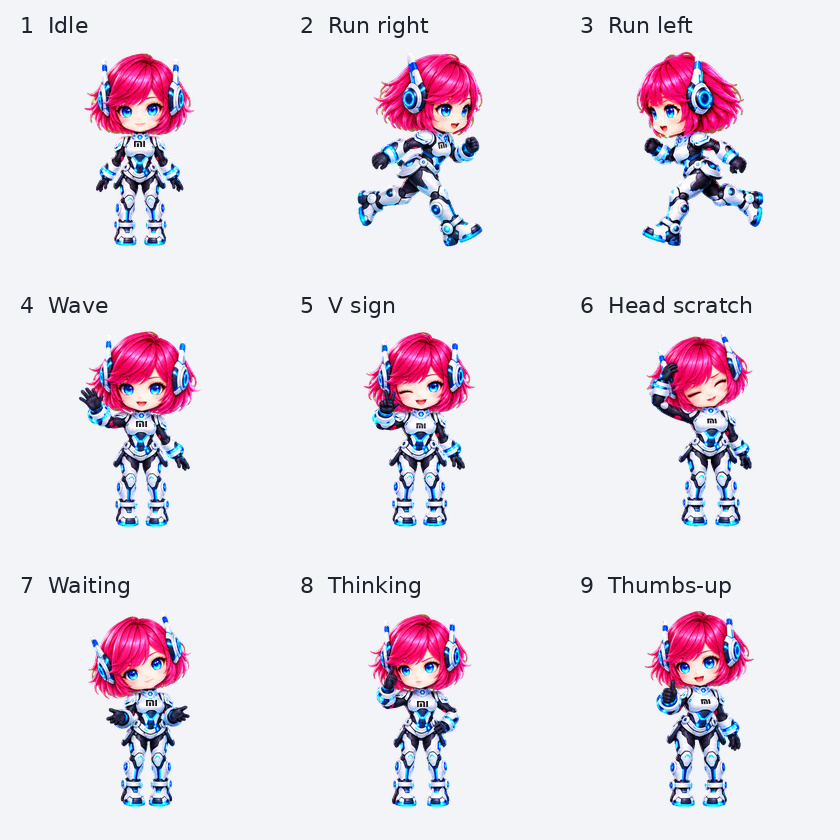
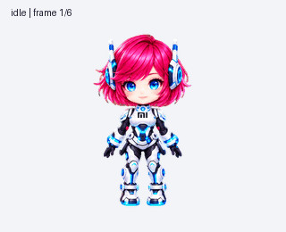

# 小爱 · ChatGPT Pet

红发蓝眼、白黑科技机甲的 Q 版小爱桌面伙伴。基于《小米超神》中“小爱同学”的形象制作，为非官方粉丝作品。



## 直接使用

在支持 **ChatGPT Pets** 的会话中发送：

```text
请领养并启用这个小爱宠物：
https://chatgpt.com/s/sharepet_6ae4cc0cf2388191977d3076414dfa8d
```

这会将共享的小爱安装为你自己的宠物副本。需要当前账户和客户端具备 Pets 功能；普通图片查看器或不支持 Pets 的客户端不能直接安装。

## 下载素材后导入

1. 下载本仓库的 ZIP 并解压，或单独下载 [`spritesheet.png`](spritesheet.png) 原图。
2. 将 `spritesheet.png` 上传到支持 Pets 的 ChatGPT 会话，发送：

   ```text
   这是已完成的 v2 宠物精灵图，请验证后直接导入并启用，保留原图，不要重新生成。
   第 4 行（从 0 开始）的 jumping 槽位已自定义为原地比耶，不要求跳跃。
   failed 槽位为歪头挠头，review 槽位为检查后点赞。
   ```

3. 导入成功后如果仍显示旧宠物，尝试刷新或重启客户端。

## 动作与规格

- 九种状态：待机眨眼、向右奔跑、向左奔跑、挥手、比耶、挠头、等待输入、思考、检查后点赞。
- 十六个视线方向，胸口 MI 标记已统一补齐；标记在手部遮挡时自然隐藏。
- v2 图集：**1536 × 2288**，8 列 × 11 行；每格 **192 × 208**；共 **73 帧**，透明 PNG。
- 动作播放时机由宿主客户端决定，本素材包不修改客户端的触发逻辑。
- 详细行定义、帧数和时长见 [`pet.json`](pet.json)。



## 文件

| 文件 | 用途 |
| --- | --- |
| `spritesheet.png` | 实际导入的透明精灵图；不要使用九宫格预览图代替 |
| `actions-overview.png` | 九种动作的静态预览 |
| `preview.gif` | 整套动画演示 |
| `preview.mp4` | 视频预览 |
| `pet.json` | 素材布局及动画元数据，不是客户端安装程序 |
| `SHA256SUMS` | 下载文件校验值 |

## 来源与权利说明

角色原型为小米“小爱同学”，参考《小米超神》中的游戏形象，以 AI 辅助制作 Q 版宠物素材。角色、MI 标记及相关商标的权利归相应权利人所有；本项目与小米、OpenAI 均无官方隶属或授权关系。

本仓库不主张原角色或商标的所有权，也不授予其商业使用许可。对外使用、修改或再分发时，请自行确认适用的权利和授权。

游戏形象来源：[17173《小米超神》角色介绍](https://news.17173.com/content/12132018/100019292.shtml)。
